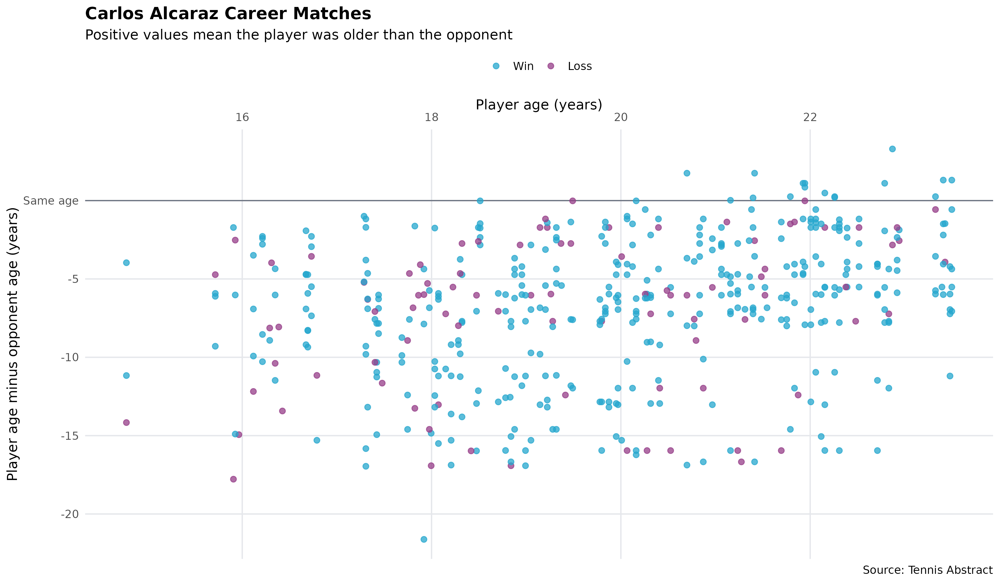

# tenniscareer

An R package for retrieving tennis career match records from
[Tennis Abstract](https://www.tennisabstract.com/) and plotting a player's
age relative to their opponents.

Created for UC Berkeley STAT 159 HW3. Carlos Alcaraz is the featured
example, but the package supports other players.

## Installation

Install directly from GitHub:

```r
install.packages("remotes")
remotes::install_github("UCB-stat159-f26/hw03-3-vincentchen1")
```

For a private repository, installation requires GitHub authentication
with access to the repository. Do not put access tokens in scripts.

## Public functions

### Retrieve matches

```r
library(tenniscareer)

carlos <- get_player_matches("Carlos Alcaraz")
head(carlos)
```

Spaced and CamelCase names are supported:

```r
serena <- get_player_matches("serena williams")
serena <- get_player_matches("Serena Williams")
serena <- get_player_matches("SerenaWilliams")

rafa <- get_player_matches("Rafael Nadal")
```

An unknown player produces a meaningful error:

```r
get_player_matches("GastonSanchez")
# Error: No player found for 'GastonSanchez'.
```

The returned data frame contains:

| Column | Meaning |
|---|---|
| `player` | Player's name |
| `match_date` | Date supplied by Tennis Abstract |
| `tournament` | Tournament name |
| `surface` | Playing surface |
| `result` | Result code, including W or L |
| `opponent` | Opponent's name |
| `player_age` | Player's age in decimal years |
| `opponent_age` | Opponent's age in decimal years |

Ages derived from birth dates use elapsed days divided by 365.25.
Opponent ages already supplied as numeric values are preserved.
Missing or invalid opponent ages remain `NA`.

### Plot matches

```r
plot_career_matches(carlos)
```

The horizontal axis shows the player's age. The vertical axis shows
player age minus opponent age:

- Positive values: the player was older.
- Negative values: the player was younger.
- Zero: the players were the same age.

Blue points represent wins; purple points represent losses. Rows with
missing ages or results other than W/L are omitted with a warning.

The function returns a ggplot object:

```r
p <- plot_career_matches(carlos)

ggplot2::ggsave(
  "carlos_plot.png", plot = p,
  width = 12, height = 7, dpi = 300
)
```

## Carlos Alcaraz example



The saved snapshot contains 487 records dated February 12, 2018,
through November 2, 2026. These are the records returned by the source
at retrieval time, not an independently verified count of matches played.

To reproduce the example, install the package, open a terminal in the
repository root, and run:

```bash
Rscript scripts/create_carlos_example.R
```

The script reuses `outputs/carlos_alcaraz_matches.csv` when it exists,
allowing the saved figure to be reproduced without another download.
If the snapshot is absent, the script downloads data and records the
retrieval date in `outputs/carlos_alcaraz_source.txt`.

## Data retrieval and limitations

The package resolves names through Tennis Abstract's search endpoint.
For players with standalone JS files, it combines historical and regular
match arrays. Overlapping records are identified using date, tournament,
round, and opponent; regular-file records take priority.

When a legacy file returns HTTP 404, the package instead reads the
match array embedded in the player's classic profile. This supports
Carlos Alcaraz, whose standalone files were unavailable during development.

Website formats, coverage, and freshness vary between players. For example,
the Nadal standalone files inspected during development ended in 2018.
The package does not independently establish that a source contains every
career match. Website changes may require updates to the retrieval code.

Dates may represent tournament dates rather than the exact day each
match was played. Age calculations therefore inherit that limitation.
Source records can also include walkovers or other entries that should
not automatically be interpreted as matches played.

I ultimately decided on doing my graphic on Carlos Alcaraz since he is
a player that is special to both me and my friend.

## Testing

Install the testing tools and run the suite from the repository root:

```r
install.packages(c("testthat", "pkgload"))
testthat::test_local()
```

Automated tests use local JS fixtures, synthetic profile HTML, and mocked
downloads. They do not contact live servers.

Tests cover parsing, cleaning, female and male age formats, name lookup,
invalid inputs, overlapping sources, classic-profile fallback, and plotted
coordinates and colors.

## Personal reflections

One thing I learned was that getting a successful download does not
automatically mean the data is complete. When I checked Nadal's records,
the historical file stopped in 2016. Combining sources added more records,
but I still had to be careful about describing what the website actually
provided.

I also learned why it helps to separate downloading, parsing, cleaning,
and plotting into smaller functions. The female and male examples stored
opponent ages differently, and Carlos's data used a different page format.
Having separate functions made these differences easier to handle.

Writing offline tests helped me check the code without repeatedly
requesting data from the website. I also got more comfortable making
focused commits and checking that my changes were actually pushed to
main. Keeping a saved data snapshot made the example more reproducible
because the website can change after the assignment is finished.

## Dependencies and development

Runtime dependencies are declared in `DESCRIPTION`: ggplot2, httr2,
and jsonlite. testthat is listed as a suggested dependency for testing.

As specified in HW3, this package does not require a Makefile or
environment.yml.

## Sources and license

- Data: [Tennis Abstract](https://www.tennisabstract.com/)
- Visualization reference:
  [New York Times Serena Williams age comparison](https://www.nytimes.com/interactive/2022/08/28/sports/tennis/serena-age-opponents.html)

The plot uses the reference's age-comparison concept without narrative
annotations.

Package code is released under the MIT license. The code license does
not grant rights to third-party data or graphics.